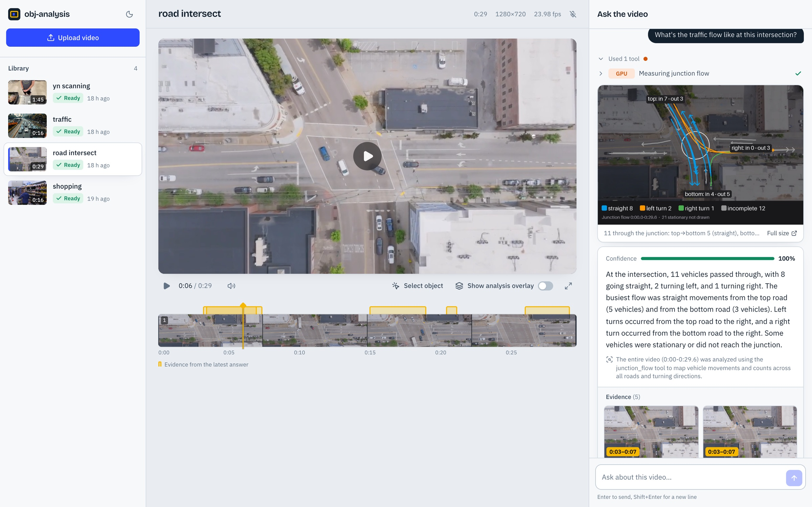
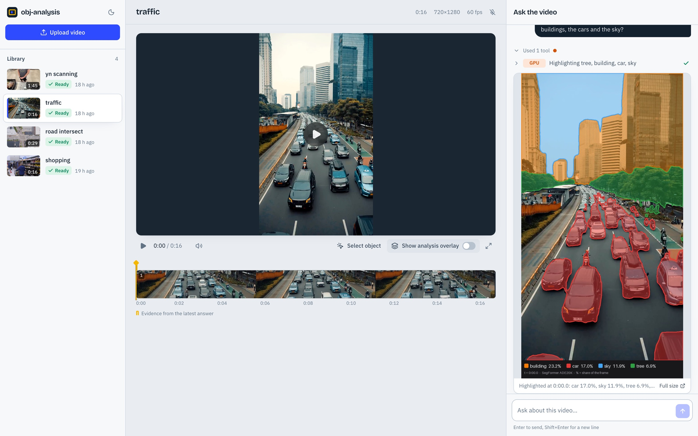
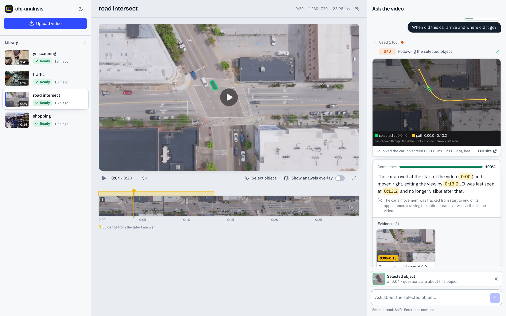
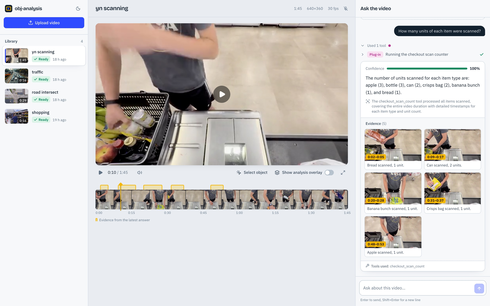
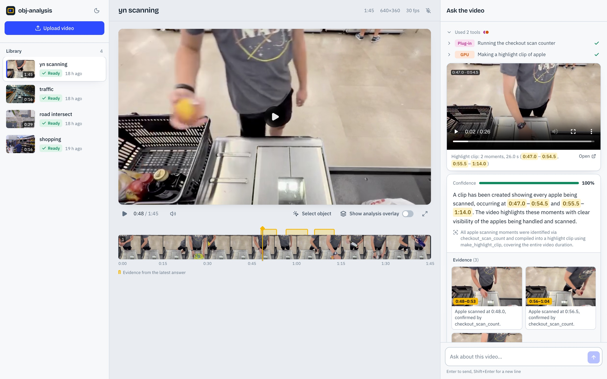
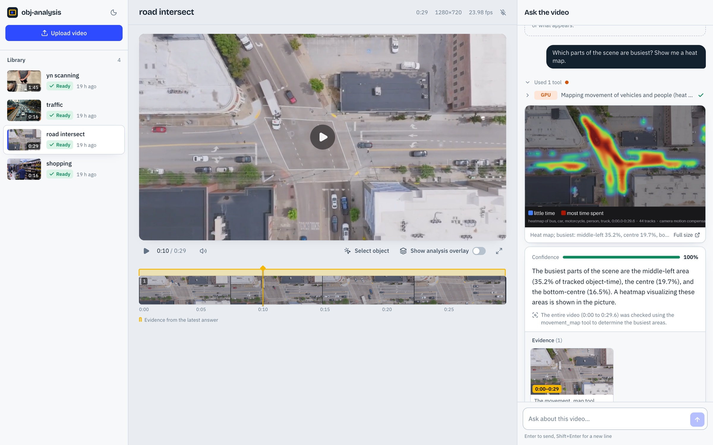
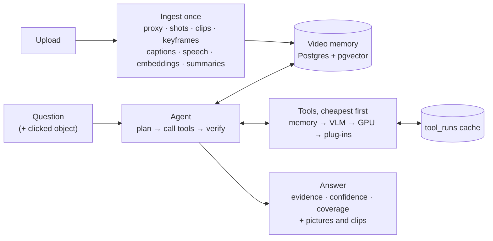

# obj-analysis

**Ask questions about any video and get answers backed by evidence.**

Upload a video and it is indexed once into a searchable *video memory*. After that you can ask things like:
- "How many units of each item were scanned?"
- "What's the traffic flow at this intersection?"
- "Show me the sky, trees, buildings and cars as different classes."
- "When did *this* car arrive?" (after clicking the car)

An agent answers using a set of tools. It runs heavy vision models (detection, segmentation, tracking) only when a question needs them, caches every result, and shows timestamped evidence, pictures and clips for its answers.

All of it runs on a laptop: Qwen3-VL through Ollama, Postgres with pgvector, and PyTorch on Apple silicon. The same code runs on a GPU server with vLLM and Celery.



## What it can do

| | |
|---|---|
|  |  |
| **Scene segmentation.** "Highlight the trees, buildings, cars and sky." Every pixel is coloured by class, and the legend shows each class's share of the frame. | **Click to ask.** Pause, click an object, ask "when did this car arrive and where did it go?". SAM outlines it and the agent follows its track. |
|  |  |
| **Checkout counting.** Units per item type, including several units scanned at once. Each counted trip is evidence you can jump to on the timeline. | **Highlight clips.** "Make me a clip of every apple being scanned." One short video, each piece stamped with its original time. |
|  | **Junction flow** (top screenshot). Which road each vehicle came from and left by (straight, left turn, right turn, U-turn), with a picture of every path. The junction centre is found by the vision model, and the roads are found from the trails themselves, so diagonal roads and T-junctions work too. Each turn's time range can be turned into a highlight reel. |
| **Movement heat maps and trails.** Where objects spend their time, or the path each one took, with drone camera drift corrected. | |

Also included:
- **General analysis:** a narrated summary with key moments.
- **Object counting:** distinct objects, or how many are visible at one moment.
- **Zones:** line crossings and region dwell times.
- **Analysis overlay:** a tracking overlay video on the player.
- **Live progress:** ingestion progress streams to the dashboard.

## How it works



1. **Index once.** ffmpeg makes a 720p proxy. PySceneDetect splits it into shots, and the shots are cut into clips of 8 s or less. Qwen3-VL captions each clip, faster-whisper transcribes the speech, and bge and SigLIP embed the text and keyframes. Summaries are written per scene and for the whole video.
2. **Answer with tools.** A router sends "summarise this" to a report built from the memory. Anything else goes to an agent loop where the model calls tools through a JSON action protocol, starting with the cheapest that can answer: memory search, then VLM looks at specific frames, then GPU vision models, then plug-ins.
3. **Cache everything expensive.** GPU results are stored under a hash of their parameters, so asking again is instant and tools share each other's tracks.
4. **Stay grounded.** Totals are added up in code. Any number in the answer that doesn't appear in a tool result triggers a rewrite and lowers confidence. A detector finding zero objects is treated as a possible miss, not as proof of absence.
5. **Match the models to the camera.** Drone footage gets YOLO11-OBB (trained on aerial images) and a SegFormer trained on drone footage. Ground-level footage gets YOLO-World and an ADE20K SegFormer.

The full design, with diagrams of the system, ingestion, agent loop, caching, data model and deployment, is in **[docs/ARCHITECTURE.md](docs/ARCHITECTURE.md)**.

## Tech stack

| Area | Used |
|---|---|
| Frontend | React 18 · TypeScript · Vite 7 · Tailwind 4 · TanStack Query · SSE |
| Backend | Python 3.12 · FastAPI · SQLAlchemy 2 · Celery (optional) |
| Data | Postgres 18 + pgvector · local disk or S3/MinIO |
| Vision-language | Qwen3-VL 8B through Ollama or vLLM (any OpenAI-compatible endpoint) |
| Vision | YOLO-World · YOLO11s-OBB · SAM 2.1 · ByteTrack · SegFormer (ADE20K, UAVid) |
| Embeddings and speech | bge-small-en-v1.5 · SigLIP · faster-whisper |
| Media | ffmpeg · OpenCV · PySceneDetect · Pillow |

## Quick start (Mac, no Docker)

Prerequisites: [Homebrew](https://brew.sh), [uv](https://docs.astral.sh/uv/) and Node 20+.

```bash
# 1. Services: ffmpeg, Postgres 18 + pgvector (project-local cluster on port 5434), Ollama
brew install ffmpeg postgresql@18 pgvector ollama
PG=/opt/homebrew/opt/postgresql@18/bin
$PG/initdb -D backend/data/pg18 --auth=trust                       # first time only
$PG/pg_ctl -D backend/data/pg18 -o "-p 5434 -k /tmp" -l backend/data/pg18.log start
$PG/createdb -h /tmp -p 5434 videointel                             # first time only

# 2. Vision-language model: Qwen3-VL 8B with a 32k context, so multi-frame prompts aren't cut off
brew services start ollama
ollama pull qwen3-vl:8b
printf 'FROM qwen3-vl:8b\nPARAMETER num_ctx 32768\n' > /tmp/Modelfile
ollama create qwen3-vl-32k -f /tmp/Modelfile

# 3. Backend: http://localhost:8010
cd backend
uv venv --python 3.12 && uv pip install -e ".[ml,dev]"
cp .env.example .env
.venv/bin/uvicorn app.main:app --port 8010

# 4. Frontend: http://localhost:5173
cd ../frontend && npm install && npm run dev
```

Open http://localhost:5173, upload a video and wait for ingestion to finish, then ask away. The vision models (YOLO, SAM, SegFormer, SigLIP, bge, Whisper) download on first use.

`TASK_MODE=inline`, the default, runs ingestion and GPU tools in background threads inside the API, so you don't need Redis or Celery locally. To use a larger or hosted model for the agent's reasoning, set `AGENT_BASE_URL`, `AGENT_MODEL` and `AGENT_API_KEY` in `backend/.env`.

### On a GPU server

```bash
docker compose up --build      # dashboard on http://localhost:8080
```

This starts Postgres with pgvector, Redis, MinIO, vLLM serving Qwen3-VL-8B, the API, the CPU and GPU Celery workers, and the dashboard. It needs an NVIDIA GPU and the NVIDIA container toolkit.

## Project layout

```
backend/
  app/
    api/          REST + SSE endpoints (videos, chat, click-to-ask selection)
    ingest/       ingestion pipeline (probe → proxy → shots → … → summaries)
    agent/        router, tool loop, grounding checks, general analysis report
    tools/        tool registry and tools: memory, vlm, vision, scene, motion,
                  clips, selection, plugins/checkout
    core/         config, database, storage, media helpers, task runner
  worker/         Celery app (cpu and gpu queues)
  scripts/        command-line helpers: ask a question, watch ingestion, run the checkout counter
frontend/src/
  components/     library, player + timeline, chat (answers, steps, pictures, clips)
  state/          player clock, chat streaming, object selection
docs/             ARCHITECTURE.md, api-contract.md, screenshots
eval/             evaluation questions and scoring script
```

Ask from the terminal (the API must be running):

```bash
cd backend && .venv/bin/python scripts/ask.py <video-id> "How many cars turned left?"
```

## Evaluation

```bash
cd backend && .venv/bin/python ../eval/run_eval.py      # API must be running
```

The script uploads and ingests any sample video that hasn't been processed yet, from the repo root. It then asks every question in `eval/questions.yaml` and reports:
- verdict accuracy;
- evidence overlap;
- latency;
- how many questions were answered without GPU tools.

Results on the sample videos used during development:

| Video | Result |
|---|---|
| Checkout | 12 units over 6 item types, matching a frame-by-frame manual count |
| Drone intersection | 26 vehicles in the first frame; 11 vehicles through the junction (8 straight, 2 left, 1 right), each checked against the footage |
| Street traffic | Sky, buildings, trees and cars segmented cleanly |

## Limitations

- **The default agent is a small 8B local model.** Safeguards stop it inventing numbers, but it sometimes makes an extra tool call. A larger agent model plans better.
- **Counts are approximate.** Tracks can break when objects are hidden, and the tools say so in their output.
- **Tuned on a few videos.** Junction flow, the checkout counter and look-alike matching were tuned on the sample videos.
- **Licences.**
  - NVIDIA's SegFormer weights are released for non-commercial use.
  - The UAVid drone model is trained on a CC BY-NC-SA dataset.

  Check them before any commercial use.

More detail is in [docs/ARCHITECTURE.md](docs/ARCHITECTURE.md#10-known-limitations).
