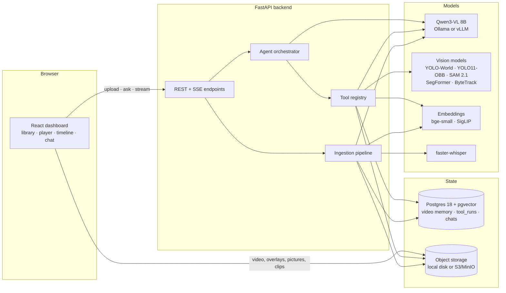
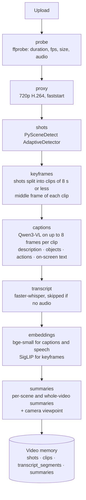
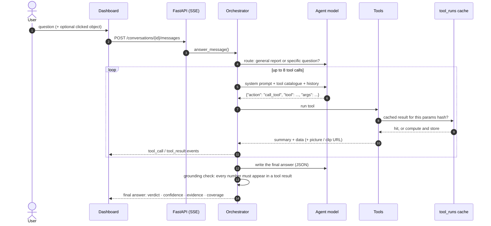
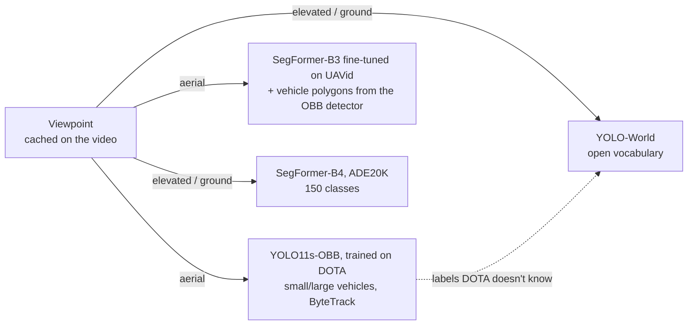
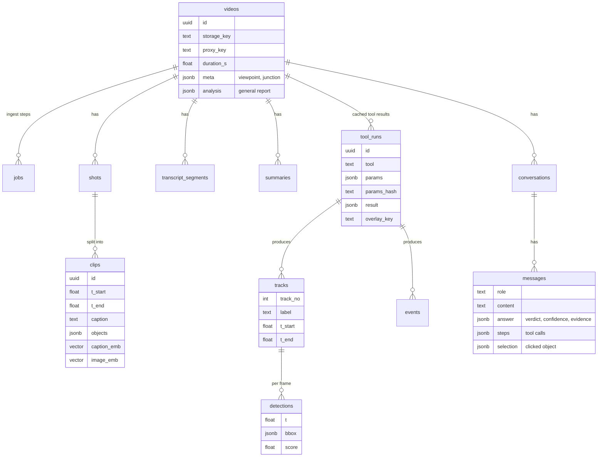
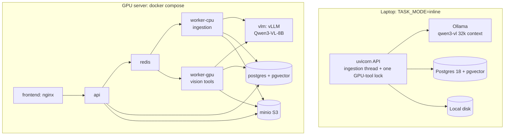

# Architecture

This document explains how obj-analysis turns a video into answers. For setup, see the [README](../README.md). For the HTTP API, see [api-contract.md](api-contract.md).

- [1. Design principles](#1-design-principles)
- [2. System overview](#2-system-overview)
- [3. Ingestion: building the video memory](#3-ingestion-building-the-video-memory)
- [4. The agent](#4-the-agent)
- [5. Tools and cost tiers](#5-tools-and-cost-tiers)
- [6. Choosing models by camera viewpoint](#6-choosing-models-by-camera-viewpoint)
- [7. Feature internals](#7-feature-internals)
- [8. Data model](#8-data-model)
- [9. Running modes and deployment](#9-running-modes-and-deployment)
- [10. Known limitations](#10-known-limitations)

## 1. Design principles

1. **Index once, query many times.** Every upload is turned into a searchable *video memory* once: shots, short clips, captions, keyframes, embeddings, speech and summaries. Most questions are answered from that memory, without touching the video again.
2. **Run expensive work only when a question needs it.** Detection, segmentation, tracking, counting and the checkout plug-in are *tools* that the agent calls on demand. Each tool result is cached by a hash of its parameters, so asking again is instant and follow-up questions reuse earlier tracks.
3. **Every answer needs evidence.** Answers come with timestamped evidence, a coverage note and a confidence score. Any number in an answer must appear in a tool result, and the code adds up totals so the language model doesn't.
4. **Models are replaceable.** The vision-language model and the agent model sit behind OpenAI-compatible endpoints: Ollama on a laptop, vLLM on a GPU server, or a hosted API.

## 2. System overview

| Layer | Technology |
|---|---|
| Frontend | React 18, TypeScript, Vite 7, Tailwind 4, TanStack Query 5; SSE for live progress and streamed answers |
| API | FastAPI, SQLAlchemy 2, Pydantic settings |
| Database | Postgres 18 with pgvector (vector search) and full-text search |
| Storage | Local disk served at `/media`, or S3/MinIO with pre-signed URLs |
| Background work | In-process threads (`TASK_MODE=inline`), or Celery with separate `cpu` and `gpu` queues |
| Media | ffmpeg (proxy, cuts, encoding), OpenCV, PySceneDetect |

## 3. Ingestion: building the video memory

An upload goes through eight steps. Each step updates a row in `jobs`, and the dashboard streams that progress over SSE.

**Searching the memory.** `search_moments` runs four searches and merges the results with reciprocal rank fusion:
1. caption embeddings;
2. keyframe image embeddings, matched by SigLIP text-to-image;
3. transcript embeddings, which boost the clips they overlap;
4. Postgres full-text search over captions, on-screen text and object lists.

## 4. The agent

How the loop works:
- **Router.** "Summarise this video" goes to a general report built from the summaries and timeline. Everything else enters the tool loop. A message that comes with a clicked object always enters the loop.
- **JSON action protocol.** The model replies with one JSON object per turn. This works on small local models that don't support native function calling.
- **Guards.**
  - There is a budget of tool calls per question.
  - Identical repeated calls are refused.
  - The ID of the clicked object is filled in by the code, never typed by the model.
  - Verdicts like "yes"/"no" are only allowed on yes/no questions. A request like "Can you show me…" is treated as a request, not a yes/no question.
- **Number grounding.** If the answer contains a number that isn't in any tool result, the model is asked for one rewrite. If that rewrite still has unsupported numbers, confidence is capped at 0.4 and the coverage note says so.
- **System prompt rules.** These cover counting (distinct objects vs. at one moment), zero-result handling ("the detector may have missed it; verify"), pictures, movement, clips and selected objects.

## 5. Tools and cost tiers

The agent sees each tool with a cost tier and is told to prefer the cheapest tier that can answer.

| Tier | Tool | What it does |
|---|---|---|
| Memory | `get_overview` | Video summary, scene summaries, viewpoint |
| | `search_moments` | Hybrid search for candidate moments (captions, images, speech, text) |
| | `get_timeline` | Clip-by-clip captions for a time range |
| VLM | `watch_clip` | Up to 16 frames of a short range with a focused question |
| | `inspect_frame` | One frame at full detail |
| | `describe_selection` | The clicked object, outlined, plus a close-up |
| GPU | `detect_objects` | Open-vocabulary detection: how many at time *t*, first appearance |
| | `segment_and_track` | Detection + ByteTrack (+ SAM masks): stable track IDs |
| | `count_objects` | Distinct objects over a range, from tracks |
| | `zone_events` | Line crossings and region enter/exit, with camera-motion compensation |
| | `segment_scene` | Picture with every pixel coloured by class (sky, tree, building, car…) |
| | `movement_map` | Trails coloured by heading, or a heat map of time spent |
| | `junction_flow` | Turning movements at a junction, with a picture of the paths |
| | `make_highlight_clip` | Cuts moments into one stamped highlight video |
| | `follow_selection` | Path and time on screen of the clicked object |
| | `find_selection_elsewhere` | Look-alikes of the clicked object elsewhere in the video |
| Plug-in | `checkout_scan_count` | Units per item type scanned at a till |

**Caching.** GPU and plug-in tools go through `call_gpu`, which hashes `tool name + parameters` (parameters include a version number, so changing the method invalidates old results). If a finished row exists in `tool_runs`, it is returned immediately. Otherwise the tool runs and stores:
- its JSON result in `tool_runs`;
- tracks and detections in `tracks` / `detections`;
- overlay videos, pictures and clips in storage.

Tools that build on tracks (`count_objects`, `zone_events`, `movement_map`, `junction_flow`, `make_highlight_clip`, `follow_selection`) all reuse the same cached tracking run.

## 6. Choosing models by camera viewpoint

Ground-level detectors miss small vehicles seen from straight above, and segmentation models trained on street photos label rooftops and roads wrongly. During ingestion the VLM classifies the camera viewpoint once (aerial, elevated or ground), and the tools pick models to match:

Generic words are expanded before detection, so "vehicle" becomes car, truck, bus and motorcycle, and the results report group totals.

## 7. Feature internals

### Checkout counting (plug-in)
1. **Label every frame.** Qwen3-VL labels the item in the shopper's hand or on the scanner, at 2 fps, in batches of 8 frames. Each batch is given the item names seen so far.
2. **Bridge short gaps.** If the same item type appears on both sides of a gap, the gap is joined. Gaps of up to 4 s first get a "is the item still present?" check.
3. **Split into trips.** A new trip starts when the item type changes and stays changed for at least 4 frames. Near-duplicate names are merged.
4. **Recount close up.** Each trip gets a close-up recount of how many units were handled together (for example, two cans at once).
5. **Total in code.** The totals are added up by the code, not the model.

On the sample video the result matches a frame-by-frame manual count: 12 units across 6 item types.

### Movement maps and junction flow
1. **Stabilise.** Track positions are mapped into one reference frame using an ORB + RANSAC homography, so the trails stay in place when a drone drifts. Ground-level footage uses the bottom of each box (the ground contact point); aerial footage uses the box centre.
2. **Classify movement.** A track counts as moving if it travels more than 5% of the frame diagonal; otherwise it is stationary (parked, or waiting the whole time).
3. **Locate the junction.** The VLM points at the junction centre once per video, and the result is cached. If that fails, the code estimates the centre from where paths travelling in different directions cross.
4. **Find the roads.** The roads are the peaks in a smoothed circular histogram of the angles where paths start and end. This handles diagonal roads and T-junctions.
5. **Name each movement.** A vehicle's entry road is where its path starts and its exit road is where it ends. The turn type follows from the angle between them. This is pure geometry, so it works for both left- and right-hand traffic.
6. **Record when it happened.** Each turn's time range is when the vehicle was actually inside the junction, not the time it spent queuing. That's what makes highlight reels of turns possible.

### Highlight clips
Moments can come from three sources:
1. time ranges taken from earlier tool results;
2. the arrival of each tracked object of a type (cars parked for the whole video are left out);
3. on checkout footage, the trips for an item type, such as "every apple".

The moments are padded and merged. ffmpeg cuts each one and overlays a badge with its original time; the badge is drawn with Pillow because the build has no `drawtext` filter. The pieces are then joined into one MP4.

### Click to ask
1. **Click.** The dashboard sends the frame time and the click point as fractions of the frame, correcting for letterboxing.
2. **Outline.** SAM 2.1 segments the object under that point. The outline and a close-up crop are cached as a `select_object` tool run, and the selection ID is that run's ID.
3. **Ask.** The selection travels with each chat message until it is cleared. The agent gets a short note describing it, and three tools that act on it:
   - **`describe_selection`:** the VLM looks at the outlined frame plus the close-up.
   - **`follow_selection`:** finds the cached track under the click (best overlap, then longest track) and joins track pieces broken by brief occlusion. It returns when the object was first and last seen, which way it went, and a picture of its path.
   - **`find_selection_elsewhere`:** compares the object with every other track of the same type, using an HSV colour histogram (60%) plus SigLIP similarity (40%). It reports "likely the same" only when both scores are high.

### Scene segmentation
Semantic segmentation labels every pixel with a class instead of drawing boxes, so regions like sky, road and tree canopy can be highlighted. The output is the frame with a translucent fill per class, outlines, and a legend showing each class's share of the frame. On aerial footage, vehicle polygons from the OBB detector are painted in as well, because the UAVid model misses grey and dark cars.

## 8. Data model

## 9. Running modes and deployment

On an Apple-silicon Mac, a Qwen3-VL call through Ollama takes about 3.5 s per image whatever the image size, so the number of frames sent is what drives cost. Rough timings on this hardware:

| Job | Time |
|---|---|
| First checkout labelling pass on a 105 s video | About 20 minutes; cached afterwards |
| Tracking a 30 s 720p clip | 20–40 s |
| Scene segmentation | 2–7 s per picture |
| SAM click outline | Under 1 s once loaded |

A GPU server running vLLM is much faster.

## 10. Known limitations

- **Small agent model.** The default agent is the same 8B model as the VLM. It sometimes makes an unnecessary tool call or misformats a time. The safeguards above catch made-up numbers, but a larger agent model (set `AGENT_*` in `.env`) plans better.
- **Tracks break.** A track can split when an object is hidden for a while, so distinct counts are approximate. The tools say so in their output.
- **Tuned on the sample videos.** Junction flow, the checkout counter and the look-alike threshold were tuned on these videos and should be validated on more footage.
- **Directions are as seen in the picture.** Road and heading names ("top", "heading left") describe the frame, not compass directions.
- **Licences.**
  - NVIDIA's SegFormer weights are released for non-commercial use.
  - The UAVid drone model is trained on a CC BY-NC-SA dataset.

  Check both before any commercial use.
